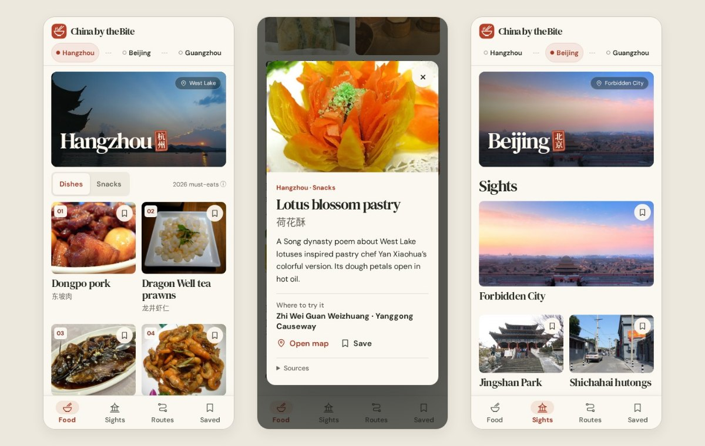

<p align="center">
  
</p>

# China by the Bite

Order from a photo, find the shop that serves the dish, then take a walk. This English-language pocket guide follows a trip through **Hangzhou, Beijing and Guangzhou**, with Chinese dish names you can show at the table.

| City | At the table | On foot |
| --- | --- | --- |
| [Hangzhou](https://emmaok1.github.io/china-by-the-bite/#hangzhou/eat) | Dragon Well tea prawns, Dongpo pork and lotus blossom pastries | Follow the shore of West Lake |
| [Beijing](https://emmaok1.github.io/china-by-the-bite/#beijing/eat) | Peking duck, copper-pot lamb and candied hawthorn | See the palace rooftops from Jingshan |
| [Guangzhou](https://emmaok1.github.io/china-by-the-bite/#guangzhou/eat) | White-cut chicken, har gow and silky rice noodle rolls | Walk from the lanes of Xiguan to Shamian Island |

## Inside the guide



**Food** covers 31 dishes and snacks. Tap a photo for its Chinese name, a short food story, a specific restaurant and an AMap link. Hangzhou follows the published order of the city's 2026 must-eat lists. Beijing and Guangzhou are editorial selections for a first visit.

**Sights** pairs nine landmarks with local history and something to look for when you arrive. **Routes** offers one half-day walk per city. **Saved** keeps your bookmarks in the browser on the device you use.

## Run it locally

From the repository root, run this command and open [the local guide](http://localhost:8000/).

```sh
python3 -m http.server 8000 --directory docs
```

## Publish with GitHub Pages

In **Settings → Pages → Build and deployment**, select **Deploy from a branch**, choose **main** and **/docs**, then save. GitHub serves the contents of that folder directly. The city links above open the corresponding sections once the site is published. [GitHub Pages documentation](https://docs.github.com/en/pages/getting-started-with-github-pages/configuring-a-publishing-source-for-your-github-pages-site)

## Sources and photography

Each food or sight card links to its sources. To update the guide, edit [food.js](docs/food.js) for dishes and restaurants or [guide.js](docs/guide.js) for landmarks and walks.

The cover and preview use photographs cropped for this layout. The cover features har gow, the Forbidden City and Dongpo pork. Photo credits in the app and the [image attribution file](docs/credits.json) identify the original photographers, source pages and licenses for individual images. [DM Sans](docs/assets/DM-Sans-license.txt) and [DM Serif Text](docs/assets/DM-Serif-Text-license.txt) are bundled with the site.
